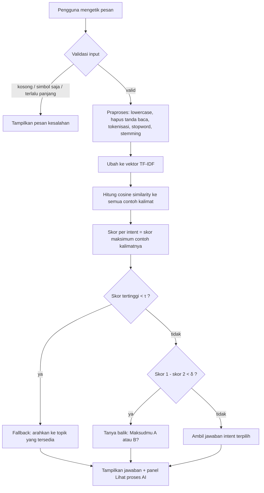

# Rancangan Sistem — Chatbot "Pelatih Pemula Catur"
UAS Kecerdasan Buatan • Kategori D (Chatbot / Virtual Assistant) • Minggu 1

> Draf awal. Tulis ulang dengan bahasamu sendiri dan sesuaikan detailnya sebelum masuk laporan (Bab I–III).

---

## 1. Latar Belakang (draf untuk Bab I)
Catur semakin populer di kalangan pemula, tetapi materi belajarnya tersebar di banyak buku, video, dan situs. Pemula sering bingung harus mulai dari mana: aturan dasar, gerakan khusus (rokade, en passant), pembukaan, taktik, sampai cara berlatih. Pertanyaan yang diajukan pun beragam bentuknya (baku, singkat, gaul, salah ketik).

Proyek ini membangun chatbot berbasis pengetahuan terstruktur yang mengenali maksud (intent) pertanyaan pemula menggunakan pemrosesan teks, pembobotan TF-IDF, dan kemiripan kosinus (cosine similarity), lalu memberi jawaban beserta penjelasan proses penalarannya.

## 2. Rumusan Masalah
1. Bagaimana merancang basis pengetahuan catur pemula yang terstruktur dalam bentuk intent, contoh kalimat, dan jawaban?
2. Bagaimana mengenali intent dari kalimat bahasa Indonesia yang bervariasi menggunakan TF-IDF dan cosine similarity?
3. Bagaimana menangani pesan yang tidak dikenali (fallback) dan pesan ambigu?
4. Seberapa akurat sistem pada skenario uji yang beragam?

## 3. Tujuan, Manfaat, Batasan
**Tujuan:** (1) membangun basis pengetahuan ≥10 intent; (2) mengimplementasikan modul pengenalan intent tanpa API AI eksternal; (3) menyediakan fallback dan klarifikasi untuk pesan ambigu; (4) mengevaluasi sistem dengan ≥5 skenario uji.

**Manfaat:** pemula mendapat jawaban cepat dan konsisten; penulis memahami penerapan representasi teks dan kemiripan vektor.

**Batasan:**
- Hanya topik catur untuk pemula (tidak membahas analisis posisi/engine, tidak memainkan permainan).
- Bahasa Indonesia saja (istilah catur dalam bahasa Inggris dikenali sebagai kata kunci).
- Basis pengetahuan statis (file JSON), tidak belajar otomatis dari percakapan.
- Prototipe akademik; jawaban bersifat edukasi umum.

## 4. Analisis Kebutuhan
**Fungsional:** terima pesan teks; validasi input; praproses; hitung kemiripan; tampilkan jawaban + intent + skor + 3 kandidat teratas; fallback; tanya balik saat ambigu; reset percakapan; halaman petunjuk.

**Non-fungsional:** respons < 1 detik; kode modular dan terdokumentasi; dapat dijalankan ulang dengan satu perintah; dependensi minimal.

**Lingkungan (usulan):** Python 3.10+, antarmuka web (Streamlit/Flask/Gradio, pilih salah satu), pustaka praproses seperti Sastrawi untuk stemming (opsional, jelaskan alasannya). TF-IDF dan cosine similarity **ditulis sendiri**.

## 5. Pemilihan Metode dan Alasan
| Komponen | Pilihan | Alasan |
|---|---|---|
| Representasi teks | TF-IDF | Sederhana, dapat dihitung manual, cocok untuk data kecil |
| Pengukuran kemiripan | Cosine similarity | Tidak terpengaruh panjang kalimat, hasil 0–1 mudah dijelaskan |
| Penentuan intent | Nearest neighbor terhadap seluruh contoh kalimat, skor intent = skor tertinggi di intent tersebut | Transparan dan bisa ditelusuri |
| Penanganan tak dikenal | Threshold τ | Menolak pertanyaan di luar domain |
| Penanganan ambigu | Margin δ antara kandidat 1 dan 2 | Memicu pertanyaan klarifikasi |

Alternatif yang dipertimbangkan namun tidak dipakai: rule-based murni (kaku terhadap variasi kalimat), klasifikasi jaringan saraf (butuh data lebih banyak, kurang transparan), dan LLM/API (tidak memenuhi syarat logika substantif).

## 6. Arsitektur dan Alur (flowchart)


## 7. Rancangan Proses AI
1. **Praproses:** lowercase → buang tanda baca/angka berlebih → tokenisasi → hapus stopword (daftar sendiri, jangan buang kata penting seperti "kuda", "raja") → stemming.
2. **TF-IDF:** `tf(t,d) = f(t,d) / |d|`, `idf(t) = ln((1+N)/(1+df(t))) + 1`, `w(t,d) = tf × idf`. N = jumlah seluruh contoh kalimat.
3. **Cosine similarity:** `cos(q,d) = (q·d) / (‖q‖ ‖d‖)`.
4. **Keputusan:**
   - skor tertinggi < **τ** → fallback
   - selisih skor intent 1 dan 2 < **δ** → klarifikasi
   - selain itu → jawab intent terpilih
5. **Nilai awal parameter:** τ = 0.25 dan δ = 0.05 (nilai tebakan; **dituning** lewat eksperimen dan hasilnya dilaporkan di Bab IV).
6. **Bila kalimat memuat sapaan + pertanyaan** (mis. "halo, kuda jalannya gimana?"): intent dengan skor tertinggi yang menang, sapaan tidak mengalahkan pertanyaan inti.

## 8. Struktur Basis Pengetahuan
File `data/intents.json`:
```json
{
  "intents": [
    {
      "tag": "gerakan_bidak",
      "label": "gerakan bidak",
      "patterns": ["kuda jalannya gimana", "..."],
      "responses": ["..."]
    }
  ]
}
```
`label` dipakai untuk kalimat klarifikasi ("Maksudmu *gerakan bidak* atau *aturan dasar*?"). Daftar 12 intent ada di `intents.json`.

## 9. Rancangan Antarmuka
- **Sidebar:** fungsi bot, topik yang bisa ditanyakan, 5–6 contoh pertanyaan, tombol *Hapus percakapan*.
- **Area utama:** riwayat chat + kolom input.
- **Di bawah tiap jawaban:** panel *Lihat proses AI* → hasil praproses, intent terdeteksi, skor, 3 kandidat teratas, status (dijawab / fallback / klarifikasi).
- **Validasi input:** pesan kosong, hanya spasi/simbol, melebihi 200 karakter.

## 10. Rencana Struktur Proyek
```
uas-ai-nim-nama/
├── data/intents.json
├── src/
│   ├── preprocess.py     # praproses teks
│   ├── tfidf.py          # TF-IDF + cosine (tulis sendiri)
│   └── chatbot.py        # threshold, fallback, klarifikasi
├── app.py                # antarmuka
├── tests/skenario_uji.md # tabel uji
├── requirements.txt
└── README.md
```

## 11. Rencana Skenario Uji Awal (diisi hasil aktual di Minggu 3)
| No | Input | Harapan |
|---|---|---|
| 1 | "kuda jalannya gimana?" | intent gerakan_bidak |
| 2 | "apa itu en passant" | intent gerakan_khusus |
| 3 | "cara menang gimana?" | klarifikasi (ambigu: taktik/pembukaan/endgame) |
| 4 | "resep nasi goreng" | fallback (di luar domain) |
| 5 | "knight move gmn" (campur bahasa + singkatan) | intent gerakan_bidak |
| 6 | "" (kosong) | pesan kesalahan validasi |
| 7 | "halo, pembukaan buat pemula apa?" | intent pembukaan |

## 12. Pemetaan ke Dokumen Penugasan
| Syarat | Rencana |
|---|---|
| ≥10 intent, contoh beragam | 12 intent, ±8 contoh tiap intent |
| Basis jawaban | `intents.json` |
| Fallback | threshold τ |
| Mekanisme pengenalan dijelaskan | TF-IDF + cosine, bagian 7 |
| Uji variasi dan ambigu | skenario 3, 5, 7 |
| Beranda/petunjuk, form+validasi, hasil+penjelasan, reset | bagian 9 |

## 13. Risiko
- Data sedikit → salah klasifikasi: perbanyak variasi kalimat (gaul, singkat, typo).
- Stemming Sastrawi bisa memotong istilah catur: uji dan buat pengecualian jika perlu.
- Parameter τ dan δ perlu eksperimen, bukan ditebak.